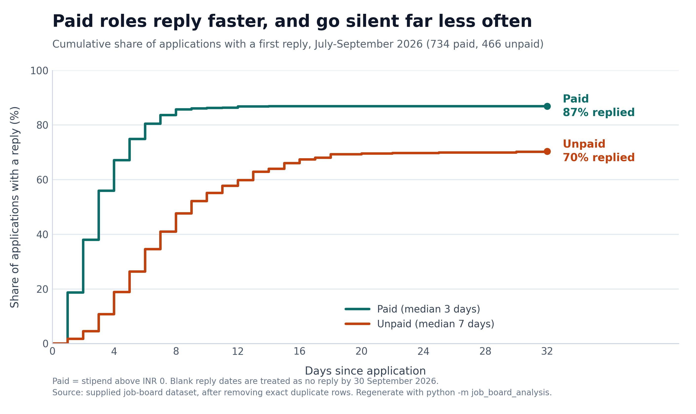

# Job board applications: three questions

I analysed 1,200 cleaned applications from July to September 2026 to answer three questions about sourcing, the application funnel and reply speed. The short version is in `MEMO.md`, the tables are in `outputs/results.md`, the method and caveats are in `docs/METHODS.md`, and the pipeline is drawn in `docs/architecture.png`.

## Answers

| Question | Answer |
|---|---|
| Which source brings the most hires per 100 applications? | **Referral: 10.7 per 100** (13 hires from 121 applications, Wilson 95% CI 6.4-17.5). Email is next at 8.1, then search 5.7, college 3.4 and social 2.3. The ranking survives role-mix adjustment, but it does not hold within every role: referral leads only Design and Marketing. |
| Are applicants who finish all 4 steps shortlisted more often? | **Yes: 48.4% versus 9.3%**, a gap of +39.1 percentage points (Newcombe 95% CI 33.8-44.3; risk ratio 5.2; p < 0.001). The gap is present in all six role categories (+34.9 to +49.0 pp). |
| How fast do paid and unpaid roles reply, and what share never reply? | **Median 3 days paid versus 7 days unpaid.** 13.1% of paid applications never heard back, versus 29.6% of unpaid ones (16.5 pp gap, Newcombe 95% CI 11.8-21.4). The gap holds by month and for applications at least 21 days old. |

These are associations in one synthetic extract, not causal effects. The memo covers what I would and would not trust.

## The chart



Cumulative share of applications that had a first reply by each day after applying, July to September 2026. Paid roles pass their median of 3 days before unpaid roles reach 7, and the gap never closes: the curves finish at 86.9% and 70.4%, which is the never-replied split in Q3.

## Project layout

```
.
├── src/job_board_analysis/
│   ├── __init__.py       public surface and version
│   ├── __main__.py       python -m job_board_analysis
│   ├── cli.py            argument parsing and the end-to-end run
│   ├── config.py         project paths and the domain vocabulary
│   ├── console.py        run log to stdout and summary.txt
│   ├── contracts.py      schema validation and cleaning
│   ├── stats.py          Wilson and Newcombe intervals
│   ├── quality.py        14 checks across 7 dimensions
│   ├── questions.py      Q1-Q3 and the reply-speed statistics
│   ├── chart.py          the cumulative reply-speed figure
│   └── report.py         ten CSVs, results.md and the run log
├── tests/                pytest suite and fixtures
├── data/                 supplied CSV and data dictionary
├── docs/                 methods note and architecture diagram
├── outputs/              generated artefacts, committed for review
├── MEMO.md               two-page manager note
└── pyproject.toml        dependencies, entry point, tool config
```

| Path | What it is |
|---|---|
| `data/job-board-applications.csv` | Supplied dataset, unchanged (1,206 rows). |
| `data/data_dictionary.md` | Columns, allowed values, missingness rules and the cleaning log. |
| `outputs/` | Ten analysis CSVs, `results.md`, `summary.txt`, `data_quality.json` and the chart. |
| `docs/METHODS.md` | Estimands, cleaning decisions, tests, robustness checks and limitations. |
| `docs/architecture.png` | Pipeline diagram: CSV through the package modules to `outputs/`, with tests and CI. |
| `tests/` | Schema contract, statistical helpers, the three questions, outputs and determinism. |
| `.github/workflows/ci.yml` | Format, lint, tests and the full pipeline on every push or pull request. |

## How to run

Tested with Python 3.13.5 on Windows. From this folder:

```bash
python -m pip install -e . --group dev
python -m job_board_analysis
```

The install step needs pip 25.1 or newer for dependency groups. It also adds a `job-board-analysis` console script. Either entry point writes the 14 files in `outputs/`. The default input is `data/job-board-applications.csv`; the default output folder is `outputs/`. Paths can be changed without editing code:

```bash
python -m job_board_analysis --data path/to/applications.csv --out path/to/outputs
```

To analyse a different extract, add `--no-expected-checks`. Structural checks still run; the assertions tied to the supplied 1,206-row file are relaxed.

```bash
python -m job_board_analysis --data path/to/new-extract.csv --out outputs-new --no-expected-checks
```

Quality gates:

```bash
python -m pytest
python -m ruff format --check .
python -m ruff check .
```

The analysis uses no randomness, no network and no timestamps. In this environment, a second run produces byte-identical CSVs, Markdown, JSON and chart files. With the default settings, the run stops if the supplied file no longer matches the expected row counts, so a changed input does not silently change the answers.

## Data cleaning

The supplied file has 1,206 rows. Six are exact duplicate rows and are removed, leaving 1,200 unique applications.

| Check | Rows affected | Action |
|---|---|---|
| Exact duplicate rows, including duplicate `application_id` | 6 | Dropped, keeping the first. 1,206 -> 1,200. |
| `work_mode` case/hyphen variants | 9 | Mapped to `remote`, `hybrid`, `on_site`. |
| Missing `source` | 15 | Labelled `unknown`; excluded from source comparisons. None was hired. |
| Blank `days_to_first_reply` | 234 | Read as "no reply by 30 September 2026", not imputed. |
| Zero stipend | 466 | Kept as valid unpaid roles. |
| Stipend values | 0 | All between INR 0 and 40,000 in INR 5,000 steps. |
| Dates, steps, yes/no values | 0 | All within range; funnel values are `yes`/`no`. |
| Funnel order | 0 | No hired without interview, no interview without shortlist. |

No rows were dropped for being outliers, and no values were imputed. The only rows removed are the six exact duplicates. The full cleaning and validation rules are in `data/data_dictionary.md`; the machine-readable checks are in `outputs/data_quality.json`.

## Method and reproducibility

The method is in `docs/METHODS.md`: formulas, confidence intervals, multiple-testing correction, robustness checks and limitations. In short, Q1 uses hires per 100 with Wilson intervals and direct role standardisation; Q2 compares shortlist rates for 4 versus 0-3 steps with a Newcombe interval for the difference; Q3 compares paid and unpaid roles with Mann-Whitney, chi-square and a Newcombe interval for the never-reply gap.

Python 3.13.5, with pandas 2.2.3, numpy 2.2.4, matplotlib 3.10.3 and scipy 1.16.0 pinned in `pyproject.toml`; dependencies are declared once, in the `[project]` table, and the package lives under `src/`. The dataset is synthetic; no names, colleges or photos are included. The test suite covers the schema contract, cleaning, statistical helpers, the three questions, generated tables, chart dimensions and rerun determinism, with a 90% coverage floor. The workflow runs the same checks on Python 3.13.

## Tools used

The code, tests and prose here were drafted with an AI assistant. It wrote the package modules, the pytest suite, this README, `docs/METHODS.md` and the architecture diagram; I set the questions and the reporting priorities, and reviewed the numbers and the wording. The git history shows what changed after the first drafts.

A disclosure is hard to verify on its own, so the work is built to be checked instead: every headline number in `MEMO.md` is asserted in `tests/test_questions.py`, `outputs/data_quality.json` records the 14 checks, and `python -m job_board_analysis` regenerates all 14 files.

