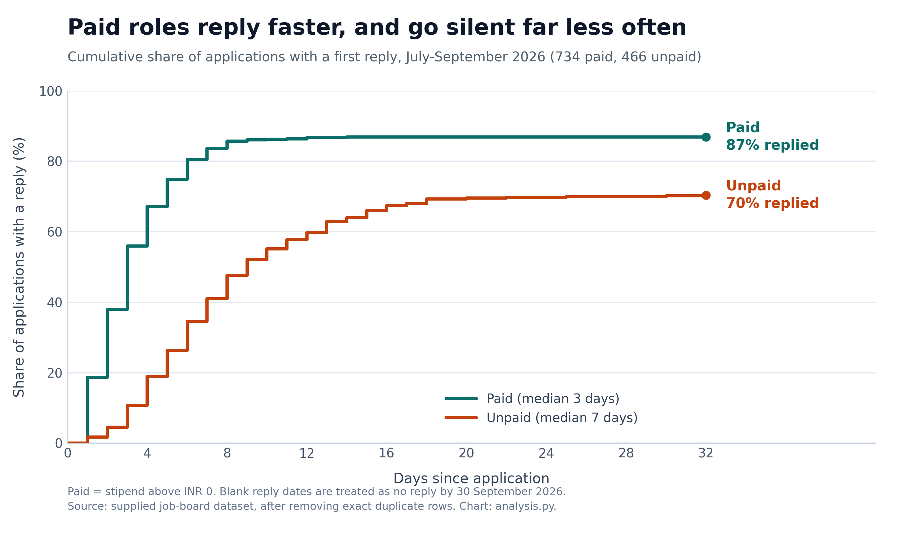

# Results: job board applications, July-September 2026

Data: 1,206 supplied rows, 6 exact duplicates removed, **1,200 applications analysed**. 269 shortlisted, 175 interviewed and 64 hired. Paid means a monthly stipend above INR 0 (734 applications); unpaid means INR 0 (466).

## Data quality

**11 pass, 2 warning, 0 fail, 1 not assessed.** Warnings: source_missing: 15 of 1,200 (1.25%); reply_date_missing: 234 of 1,200 (19.50%).

| Dimension | Check | Status | Observed |
|---|---|---|---|
| completeness | core_fields_present | pass | 0 null(s) across 9 fields |
| completeness | source_missing | warn | 15 of 1,200 (1.25%) |
| completeness | reply_date_missing | warn | 234 of 1,200 (19.50%) |
| uniqueness | application_id_unique | pass | 1,200 unique IDs |
| uniqueness | exact_duplicates_removed | pass | 6 exact duplicate row(s) |
| validity | categorical_domains | pass | 6 roles, 3 work modes, 5 ranked sources + unknown |
| validity | numeric_ranges | pass | steps 0-4; stipend >= 0; reply days 1-32 when present |
| validity | application_dates | pass | 2026-07-01 to 2026-09-30 |
| consistency | funnel_order | pass | 269 shortlisted, 175 interviewed, 64 hired |
| consistency | no_reply_rows_not_shortlisted | pass | 234 rows without a reply date |
| timeliness | snapshot_coverage | pass | snapshot ends 2026-09-30 |
| distribution | paid_unpaid_split | pass | 734 paid, 466 unpaid |
| distribution | role_coverage | pass | 6 of 6 roles present |
| accuracy | source_of_truth_reconciliation | not_assessed | No independent source |

Machine-readable version: `data_quality.json`. The accuracy check is not assessed because the supplied extract has no independent source of truth.

## Q1. Hires per 100 applications by source

| Source | Applications | Hires | Hires per 100 | CI low | CI high | Role-standardised per 100 |
|---|---|---|---|---|---|---|
| referral | 121 | 13 | 10.7 | 6.4 | 17.5 | 11.1 |
| email | 160 | 13 | 8.1 | 4.8 | 13.4 | 8.4 |
| search | 439 | 25 | 5.7 | 3.9 | 8.3 | 5.8 |
| college | 208 | 7 | 3.4 | 1.6 | 6.8 | 4.1 |
| social | 257 | 6 | 2.3 | 1.1 | 5.0 | 2.4 |

| Role | Referral | Email | Search | College | Social |
|---|---|---|---|---|---|
| Software | 7.0 (43) | 11.4 (44) | 4.8 (146) | 0.0 (73) | 1.4 (71) |
| Data | 4.8 (21) | 3.0 (33) | 7.4 (81) | 0.0 (34) | 4.4 (45) |
| Design | 23.1 (13) | 7.4 (27) | 10.6 (47) | 6.7 (30) | 3.1 (32) |
| Marketing | 22.2 (18) | 15.4 (26) | 3.8 (79) | 5.6 (36) | 4.1 (49) |
| Finance | 0.0 (8) | 0.0 (11) | 2.9 (34) | 0.0 (20) | 0.0 (27) |
| Operations | 11.1 (18) | 5.3 (19) | 5.8 (52) | 20.0 (15) | 0.0 (33) |

Cells show hires per 100 applications with the number of applications in brackets. Source-by-role cells are small; read them with the confidence intervals in `q1_role_rates.csv`.

## Q2. Shortlisting by application-step completion

| Group | Applications | Shortlisted | Shortlist rate (%) | CI low | CI high |
|---|---|---|---|---|---|
| all 4 steps | 403 | 195 | 48.4 | 43.5 | 53.3 |
| 0-3 steps | 797 | 74 | 9.3 | 7.5 | 11.5 |

| Steps done | Applications | Shortlisted | Shortlist rate (%) | CI low | CI high |
|---|---|---|---|---|---|
| 0 | 129 | 11 | 8.5 | 4.8 | 14.6 |
| 1 | 178 | 10 | 5.6 | 3.1 | 10.0 |
| 2 | 248 | 22 | 8.9 | 5.9 | 13.1 |
| 3 | 242 | 31 | 12.8 | 9.2 | 17.6 |
| 4 | 403 | 195 | 48.4 | 43.5 | 53.3 |

| Role | n (4 steps) | Shortlist % (4 steps) | n (0-3 steps) | Shortlist % (0-3 steps) | Gap (pp) |
|---|---|---|---|---|---|
| Software | 142 | 41.5 | 239 | 6.7 | 34.9 |
| Data | 64 | 51.6 | 155 | 10.3 | 41.2 |
| Design | 54 | 57.4 | 95 | 8.4 | 49.0 |
| Marketing | 65 | 52.3 | 144 | 10.4 | 41.9 |
| Finance | 38 | 47.4 | 65 | 7.7 | 39.7 |
| Operations | 40 | 50 | 99 | 14.1 | 35.9 |

Per-role confidence intervals and exact p-values are in `q2_by_role.csv`.

## Q3. Reply speed, paid versus unpaid

| Group | Applications | Replied | Never replied | Never replied (%) | Median days | Mean days | P75 days | P90 days |
|---|---|---|---|---|---|---|---|---|
| paid | 734 | 638 | 96 | 13.1 | 3 | 3.2 | 4 | 6 |
| unpaid | 466 | 328 | 138 | 29.6 | 7 | 7.6 | 10 | 14 |

| Scope | Group | Applications | Never replied (%) | Median days | Mean days |
|---|---|---|---|---|---|
| month 2026-07 | paid | 261 | 11.5 | 3 | 3.2 |
| month 2026-07 | unpaid | 137 | 27.0 | 7 | 7.7 |
| month 2026-08 | paid | 215 | 15.3 | 3 | 3.3 |
| month 2026-08 | unpaid | 167 | 34.1 | 6 | 7.6 |
| month 2026-09 | paid | 258 | 12.8 | 3 | 3.2 |
| month 2026-09 | unpaid | 162 | 27.2 | 7 | 7.6 |
| matured >=21 days | paid | 547 | 12.8 | 3 | 3.2 |
| matured >=21 days | unpaid | 352 | 30.4 | 7 | 7.8 |

Blank reply dates are treated as no reply by 30 September 2026. The 21-day maturity cut keeps applications submitted on or before 9 September 2026.

## Chart

## Method notes

- **Q1:** hires / applications x 100. Wilson 95% confidence intervals. Direct standardisation applies the overall role distribution to each source's role-specific hire rates. Fisher exact tests compare referral with each other source, with Benjamini-Hochberg adjustment across the four tests. The 15 applications with missing source (0 hires) are excluded from all source comparisons.
- **Q2:** shortlist rate for applications with `steps_done = 4` versus `steps_done` 0-3. Wilson intervals, a Newcombe 95% CI for the risk difference, risk ratio, Pearson chi-square, and the same comparison within each role with Fisher exact tests and Benjamini-Hochberg adjustment.
- **Q3:** paid = `stipend_inr_month > 0`. Median and mean days are calculated among applications that received a reply. Blank reply dates are treated as "no reply by 30 September 2026", not imputed. Never-reply shares use Wilson intervals; the gap uses a Newcombe interval. Mann-Whitney U for reply days; chi-square for never-replied. The maturity check and monthly split test whether the September snapshot drives the result.
- **Data quality:** `data_quality.json` records checks across completeness, uniqueness, validity, consistency, timeliness, distribution and accuracy. Warnings are shown rather than silently fixed.
